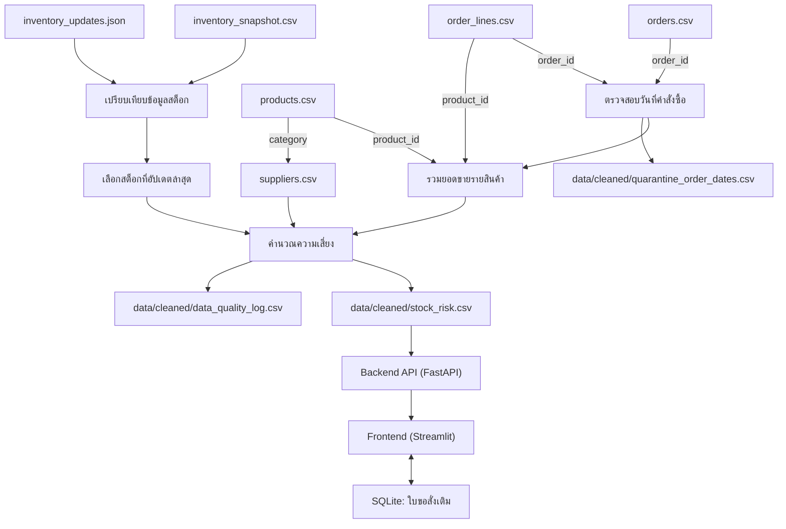
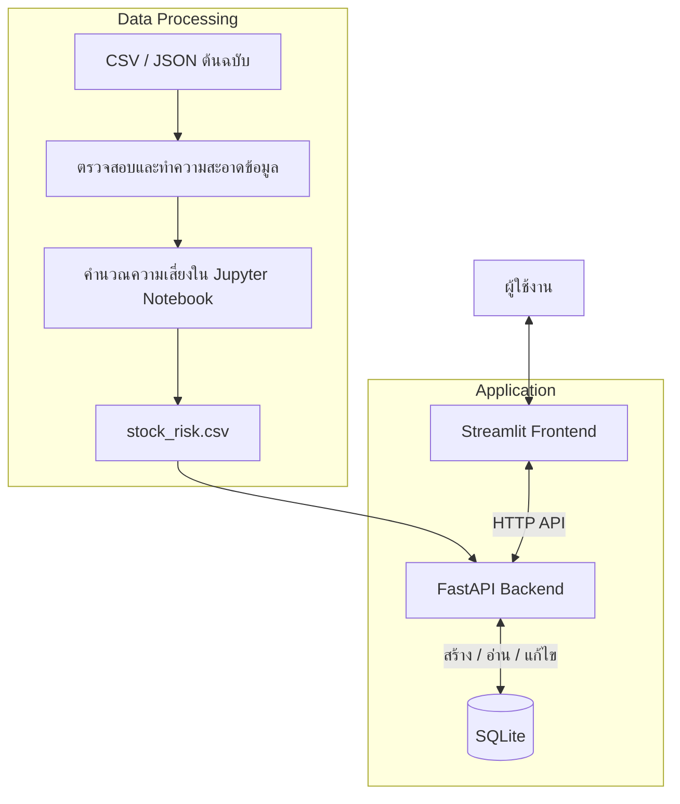

# BaanDee Living · ระบบเตือนสินค้าเสี่ยงขาดสต็อก
**BaanDee Stock Risk — Final Project**

ระบบต้นแบบสำหรับช่วยตรวจสอบสินค้าที่มีความเสี่ยงขาดสต็อก โดยรวบรวมข้อมูลสินค้า คำสั่งซื้อ และข้อมูลสต็อกจากหลายแหล่งมาตรวจสอบคุณภาพข้อมูล คำนวณจำนวนวันที่คาดว่าสินค้าจะเพียงพอต่อการขาย และแสดงผลผ่านหน้าเว็บ เพื่อให้เจ้าหน้าที่ใช้ประกอบการพิจารณาสั่งเติมสินค้า

> ระบบเป็นเครื่องมือช่วยตัดสินใจเท่านั้น ไม่ได้สั่งซื้อสินค้าโดยอัตโนมัติ และไม่ควรใช้ผลลัพธ์เป็นข้อมูลเพียงแหล่งเดียวในการตัดสินใจทางธุรกิจจริง

---

## 1. ปัญหา ผู้ใช้ และคุณค่าที่คาดหวัง

### ปัญหาที่ต้องการแก้ไข

การประเมินความเสี่ยงสินค้าขาดสต็อกต้องอาศัยข้อมูลหลายด้าน เช่น จำนวนสินค้าคงเหลือ ยอดขายย้อนหลัง ระยะเวลาจัดส่งจากผู้ขาย และเวลาที่ข้อมูลสต็อกถูกอัปเดต หากข้อมูลเหล่านี้ไม่สอดคล้องกัน ล้าสมัย หรือมีค่าที่กำกวม อาจทำให้ประเมินความเสี่ยงผิดพลาดได้

โครงงานนี้จึงพัฒนากระบวนการตรวจสอบและเตรียมข้อมูลก่อนคำนวณความเสี่ยง พร้อมแยกข้อมูลที่ยังยืนยันไม่ได้ออกจากข้อมูลที่พร้อมใช้ เพื่อไม่ให้ระบบคาดเดาข้อมูลที่ไม่แน่นอนเอง

### ผู้ใช้เป้าหมาย

- **พนักงานคลังสินค้า:** ตรวจสอบจำนวนสินค้าคงเหลือและรายการสินค้าที่มีความเสี่ยง
- **ผู้ดูแลสินค้าคงคลังหรือหัวหน้างาน:** ตรวจสอบหลักฐานประกอบและพิจารณาคำขอเติมสินค้า

### คุณค่าที่คาดหวัง

- ช่วยให้เห็นรายการสินค้าที่เสี่ยงขาดสต็อกได้ในหน้าเดียว
- ลดความเสี่ยงจากการใช้ข้อมูลสต็อกที่เก่ากว่าข้อมูลอัปเดตล่าสุด
- แยกข้อมูลที่กำกวมหรือมีหลักฐานไม่เพียงพอไว้ให้มนุษย์ตรวจสอบ
- ช่วยจัดการใบขอสั่งเติมสินค้า ตั้งแต่สร้าง ดูรายการ ไปจนถึงแก้ไขสถานะ
- ทำให้สามารถตรวจสอบที่มาและเหตุผลประกอบการประเมินได้

---

## 2. แหล่งข้อมูลและความสัมพันธ์ระหว่างข้อมูล

### แหล่งข้อมูลที่ใช้

**ข้อมูลต้นฉบับที่ได้รับจากชุดข้อมูลของอาจารย์** อยู่ใน `data/raw/`

| ไฟล์ | การใช้งาน |
|---|---|
| `orders.csv` | ข้อมูลคำสั่งซื้อและวันที่สั่งซื้อ |
| `order_lines.csv` | รายการสินค้าและจำนวนสินค้าในแต่ละคำสั่งซื้อ |
| `products.csv` | ข้อมูลสินค้าและหมวดหมู่สินค้า |
| `inventory_snapshot.csv` | ข้อมูลสต็อก ณ เวลา snapshot 06:00 |
| `inventory_updates.json` | ข้อมูลสต็อกที่อัปเดต ณ เวลา 11:40 |

**ข้อมูลที่ทีมสร้างเพิ่มเติม** อยู่ใน `data/generated/`

| ไฟล์ | การใช้งาน |
|---|---|
| `suppliers.csv` | ข้อมูลผู้ขาย ระยะเวลาจัดส่ง (`lead_time_days`) และจำนวนสั่งซื้อขั้นต่ำ (`min_order_qty`) แยกตามหมวดสินค้า |

> ข้อมูลผู้ขายใน `suppliers.csv` เป็นข้อมูลสมมติที่ทีมสร้างขึ้นเพื่อใช้ในการทดลอง ไม่ใช่ข้อมูลจริงของบริษัท

### ความสัมพันธ์ระหว่างข้อมูล

ระบบใช้ `order_id` เชื่อมข้อมูลคำสั่งซื้อกับรายการสินค้า และใช้ `product_id` เชื่อมรายการสินค้าเข้ากับข้อมูลสินค้าและสต็อก ส่วนข้อมูลผู้ขายเชื่อมกับข้อมูลสินค้าผ่าน `category`



### กระบวนการตรวจสอบคุณภาพข้อมูล

โครงงานจัดการปัญหาคุณภาพข้อมูลหลัก 3 ประเด็น

1. **วันที่คำสั่งซื้อมีรูปแบบกำกวม**
   - วันที่บางรายการอยู่ในรูปแบบ `วัน/เดือน/ปี` เช่น `07/08/2026` ซึ่งอาจตีความได้มากกว่าหนึ่งแบบ
   - ระบบไม่เดาวันที่ แต่แยกรายการไปไว้ใน `quarantine_order_dates.csv` เพื่อให้มนุษย์ตรวจสอบ และไม่นำรายการที่กำกวมไปคำนวณยอดขาย

2. **ชื่อหมวดหมู่สินค้าไม่สม่ำเสมอ**
   - ตัวอย่างเช่น `kitchen`, `bedding` และ `Bed room`
   - ระบบปรับชื่อให้ตรงกับหมวดมาตรฐานที่กำหนดใน `CATEGORY_MAP` เพื่อให้เชื่อมกับข้อมูลผู้ขายได้

3. **ข้อมูลสต็อกจากหลายแหล่งมีเวลาไม่ตรงกัน**
   - เปรียบเทียบ snapshot เวลา 06:00 กับข้อมูลอัปเดตเวลา 11:40
   - เลือกค่าที่มีเวลาอัปเดตล่าสุด และเก็บเวลา/แหล่งที่มาของข้อมูลไว้ในผลลัพธ์

ไฟล์ `data/cleaned/data_quality_log.csv` ใช้บันทึกปัญหา จำนวนแถว วิธีจัดการ และหลักฐานที่เกี่ยวข้อง ส่วนข้อมูลต้นฉบับใน `data/raw/` จะไม่ถูกแก้ไขทับ

---

## 3. Architecture และเครื่องมือที่ใช้

### ภาพรวมสถาปัตยกรรม

ระบบแบ่งเป็น 3 ชั้นหลัก ได้แก่ การประมวลผลข้อมูล (Data Processing), ระบบหลังบ้าน (Backend) และส่วนติดต่อผู้ใช้ (Frontend) โดยมี SQLite สำหรับจัดเก็บใบขอสั่งเติมสินค้า



### หน้าที่ของแต่ละส่วน

| ส่วนประกอบ | เครื่องมือ / ไฟล์ | หน้าที่ |
|---|---|---|
| Data Processing | Python, pandas, NumPy | อ่าน ตรวจสอบ ทำความสะอาด รวมข้อมูล และคำนวณความเสี่ยง |
| Notebook | `notebooks/01_clean_and_risk.ipynb` | แสดงขั้นตอนวิเคราะห์ข้อมูลและสร้างไฟล์ผลลัพธ์ |
| Backend API | FastAPI ใน `backend/api.py` | ให้บริการข้อมูลความเสี่ยง ค้นหาสินค้า และจัดการใบขอสั่งเติม |
| Frontend | Streamlit ใน `frontend/app.py` | แสดงรายการความเสี่ยง รายละเอียดสินค้า และแบบฟอร์มใบขอสั่งเติม |
| API Client | `frontend/api_client.py` | เป็นตัวกลางระหว่างหน้าเว็บกับ Backend และจัดการผลตอบกลับ/ข้อผิดพลาด |
| Mock Data | `frontend/mock_data.py` | ให้ข้อมูลตัวอย่างสำหรับทดลองหน้าเว็บโดยไม่ต้องเปิด Backend |
| Database | SQLite | เก็บใบขอสั่งเติมให้คงอยู่หลังปิดและเปิดระบบใหม่ |
| Testing | pytest | ตรวจสอบพฤติกรรมของระบบตามกรณีทดสอบ |

### เหตุผลในการเลือกเครื่องมือ

- **Python:** ใช้เป็นภาษาหลักเพราะรองรับการจัดการข้อมูลและการพัฒนา API/เว็บผ่านไลบรารีที่ใช้ในโครงงาน
- **pandas และ NumPy:** ช่วยจัดการตารางข้อมูล คำนวณยอดขายเฉลี่ย และคำนวณจำนวนวันที่สต็อกจะเพียงพอ
- **Jupyter Notebook:** ทำให้ตรวจสอบและอธิบายขั้นตอนการประมวลผลข้อมูลได้เป็นลำดับ
- **FastAPI:** แยกส่วนให้บริการข้อมูลและตรวจสอบคำขอออกจากหน้าเว็บ
- **Streamlit:** สร้างหน้าเว็บต้นแบบสำหรับแสดงผลและรับข้อมูลจากผู้ใช้ได้รวดเร็ว
- **SQLite:** จัดเก็บใบขอสั่งเติมโดยไม่ต้องติดตั้ง Database Server แยกต่างหาก
- **pytest:** ช่วยตรวจสอบพฤติกรรมสำคัญซ้ำได้อย่างเป็นระบบ

### กฎการคำนวณความเสี่ยง

1. ใช้ยอดขายในช่วง 30 วันล่าสุดที่กำหนดไว้ใน Notebook คือ 1–30 กรกฎาคม 2026
2. คำนวณยอดขายเฉลี่ยต่อวันจาก `จำนวนสินค้าที่ขายใน 30 วัน ÷ 30`
3. คำนวณจำนวนวันที่สต็อกจะเพียงพอจาก `สต็อกล่าสุด ÷ ยอดขายเฉลี่ยต่อวัน`
4. ใช้ระยะเวลาจัดส่งจาก `lead_time_days` และกำหนด Safety Days เพิ่ม 3 วัน
5. จัดสถานะตามลำดับ:
   - **ต้องให้คนตรวจ:** ไม่มีข้อมูลผู้ขาย หรือมีคำสั่งซื้อในช่วง 30 วันน้อยกว่า 3 รายการ
   - **เสี่ยง:** สต็อกเป็น 0 หรือจำนวนวันที่สต็อกจะเพียงพอน้อยกว่า `lead_time_days + 3`
   - **ปกติ:** ไม่เข้าเงื่อนไขข้างต้น

หากมีคำสั่งซื้อที่ถูกกักไว้ ระบบจะเพิ่มหมายเหตุประกอบเพื่อให้ผู้ใช้ทราบ

---

## 4. โครงสร้างโปรเจกต์

```text
baandee_stock_risk/
│
├── .streamlit/
│   └── config.toml
│
├── backend/
│   ├── __init__.py
│   └── api.py
│
├── data/
│   ├── raw/
│   │   ├── orders.csv
│   │   ├── order_lines.csv
│   │   ├── products.csv
│   │   ├── inventory_snapshot.csv
│   │   └── inventory_updates.json
│   ├── generated/
│   │   └── suppliers.csv
│   └── cleaned/
│       ├── stock_risk.csv
│       ├── data_quality_log.csv
│       └── quarantine_order_dates.csv
│
├── frontend/
│   ├── app.py
│   ├── api_client.py
│   └── mock_data.py
│
├── notebooks/
│   └── 01_clean_and_risk.ipynb
│
├── tests/
│   └── test_system.py
│
├── AI_USE.md
├── .gitignore
├── README.md
└── requirements.txt
```

| โฟลเดอร์ / ไฟล์ | หน้าที่ |
|---|---|
| `data/raw/` | เก็บข้อมูลต้นฉบับที่ได้รับมา โดยไม่แก้ไขทับ |
| `data/generated/` | เก็บข้อมูลเพิ่มเติมที่ทีมสร้างขึ้น |
| `data/cleaned/` | เก็บผลการทำความสะอาด ผลคำนวณ และรายการที่ต้องตรวจสอบ |
| `notebooks/` | เก็บ Notebook สำหรับประมวลผลข้อมูล |
| `backend/` | เก็บ Backend API |
| `frontend/` | เก็บหน้าเว็บ API Client และข้อมูลตัวอย่าง |
| `tests/` | เก็บชุดทดสอบระบบ |
| `AI_USE.md` | เปิดเผยการใช้ AI ในการพัฒนาโครงงาน |
| `requirements.txt` | รายการ Python packages ที่จำเป็น |

---

## 5. วิธีติดตั้งและเริ่มระบบ (Windows)

### 5.1 สิ่งที่ต้องเตรียม

- Windows
- Python ที่รองรับแพ็กเกจใน `requirements.txt`
- อินเทอร์เน็ตสำหรับติดตั้งแพ็กเกจในครั้งแรก

### 5.2 ดาวน์โหลดโปรเจกต์

เปิด PowerShell แล้วใช้คำสั่ง

```powershell
git clone https://github.com/Tak66Student/baandee_stock_risk.git
cd baandee_stock_risk
```

หากดาวน์โหลด ZIP จาก GitHub ให้แตกไฟล์ แล้วเปิด PowerShell ในโฟลเดอร์หลักของโปรเจกต์แทน

### 5.3 สร้าง Virtual Environment และติดตั้งแพ็กเกจ

รันคำสั่งต่อไปนี้จากโฟลเดอร์หลักของโปรเจกต์

```powershell
python -m venv .venv
.venv\Scripts\python -m pip install -r requirements.txt
```

### 5.4 เริ่มระบบ Backend

เปิด PowerShell หน้าต่างที่ 1 ในโฟลเดอร์หลักของโปรเจกต์ แล้วรัน

```powershell
.venv\Scripts\python -m uvicorn backend.api:app --port 8000
```

ปล่อยหน้าต่างนี้ให้ทำงานอยู่ เพื่อให้ Backend พร้อมรับคำขอจากหน้าเว็บ

### 5.5 เริ่มระบบ Frontend

เปิด PowerShell หน้าต่างที่ 2 ในโฟลเดอร์หลักของโปรเจกต์ แล้วรัน

```powershell
.venv\Scripts\python -m streamlit run frontend/app.py
```

เปิดเว็บเบราว์เซอร์ที่

http://localhost:8501

> ต้องเปิด Backend และ Frontend พร้อมกัน หากปิดหน้าต่าง Backend หน้าเว็บจะไม่สามารถเรียกข้อมูลจาก API ได้

### 5.6 รันการทดสอบ

เปิด PowerShell ในโฟลเดอร์หลักของโปรเจกต์ แล้วรัน

```powershell
.venv\Scripts\python -m pytest -v
```

---

## 6. กรณีสาธิตหลักและผลลัพธ์ที่คาดหวัง

### กรณีที่ 1: ดูรายการสินค้าที่มีความเสี่ยง

1. เปิดหน้าเว็บและเลือกโหมด **ระบบจริง (API ในเครื่อง)**
2. ไปที่แท็บ **รายการความเสี่ยง**
3. ตรวจสอบจำนวนสินค้าในแต่ละกลุ่มและรายละเอียดในตาราง

**ผลลัพธ์ที่คาดหวัง:** แสดงสินค้า สถานะความเสี่ยง จำนวนสต็อก เวลาของข้อมูลสต็อก ยอดขายเฉลี่ยต่อวัน จำนวนวันที่คาดว่าจะขายได้ และหมายเหตุประกอบ

จากชุดข้อมูลและผลทดสอบที่จัดเตรียมไว้ API ควรส่งข้อมูล 82 รายการ แบ่งเป็น ปกติ 70 รายการ เสี่ยง 7 รายการ และต้องให้คนตรวจ 5 รายการ

### กรณีที่ 2: ดูรายละเอียดสินค้าและหลักฐาน

1. ไปที่แท็บ **ดูสินค้ารายตัว**
2. กรอกรหัสสินค้า เช่น `SKU-0060`
3. กด **ดูหลักฐาน**

**ผลลัพธ์ที่คาดหวัง:** แสดงข้อมูลที่ยืนยันได้และข้อมูลที่ยังไม่แน่นอน หากสินค้าอยู่ในกลุ่มต้องให้คนตรวจ ระบบจะแสดงเหตุผลและเตือนให้เจ้าหน้าที่ตรวจสอบก่อนตัดสินใจสั่งเติม

### กรณีที่ 3: สร้างใบขอสั่งเติม

1. ไปที่แท็บ **ใบขอสั่งเติม**
2. เลือกสินค้าและใส่จำนวนที่ต้องการสั่ง โดยต้องมากกว่า 0
3. กด **สร้างใบขอสั่งเติม**

**ผลลัพธ์ที่คาดหวัง:** ระบบสร้างเลขที่ใบขอสั่งเติม บันทึกข้อมูลใน SQLite และกำหนดสถานะเริ่มต้นเป็น `รออนุมัติ`

### กรณีที่ 4: แก้ไขใบขอสั่งเติม

1. เลือกใบขอสั่งเติมจากรายการ
2. เปลี่ยนจำนวน สถานะ หรือหมายเหตุ
3. กด **บันทึกการแก้ไข**

**ผลลัพธ์ที่คาดหวัง:** ระบบบันทึกการแก้ไขและแสดงข้อมูลล่าสุดเมื่อเรียกดูรายการอีกครั้ง

### กรณีที่ 5: แสดงการจัดการข้อมูลผิดพลาด

ตัวอย่างการทดลอง ได้แก่ ค้นหารหัสสินค้าที่ไม่มีอยู่ เช่น `SKU-9999` หรือส่งจำนวนสั่งซื้อเป็น 0

**ผลลัพธ์ที่คาดหวัง:** ระบบแจ้งว่าไม่พบสินค้า หรือปฏิเสธจำนวนที่ไม่ถูกต้อง และไม่บันทึกคำขอที่ไม่ผ่านการตรวจสอบ

---

## 7. ผลการทดสอบระบบ

ใช้ `pytest` ทดสอบพฤติกรรมหลักของระบบทั้งหมด 10 กรณี

| Test Case | สิ่งที่ตรวจสอบ | ผลที่คาดหวัง |
|---|---|---|
| T01 | วันที่กำกวมในคำสั่งซื้อ | แยกข้อมูลไว้ตรวจสอบ ไม่เดาวันที่ |
| T02 | การเลือกข้อมูลสต็อกล่าสุด | ใช้สต็อกล่าสุดของ SKU-BD-220 คือ 12 หน่วย เวลา 11:40 |
| T03 | จำนวนรายการความเสี่ยง | 82 รายการ: ปกติ 70, เสี่ยง 7, ต้องให้คนตรวจ 5 |
| T04 | ค้นหาสินค้าที่ไม่มีอยู่ | ได้ HTTP 404 |
| T05 | สร้างคำขอด้วยจำนวน 0 | ได้ HTTP 400 และไม่บันทึกคำขอ |
| T06 | สร้างคำขอให้สินค้าที่ไม่มีอยู่ | ได้ HTTP 404 |
| T07 | สร้างและแก้ไขคำขอ | ข้อมูลใหม่ถูกบันทึกและเรียกกลับได้ |
| T08 | แก้ไขคำขอที่ไม่มีอยู่ | ได้ HTTP 404 |
| T09 | Backend ไม่พร้อมใช้งาน | API Client คืนสถานะ `unavailable` |
| T10 | Frontend/API Client ตรวจจำนวนติดลบ | คืนสถานะ `error` ก่อนส่งคำขอไป Backend |

ผลการทดสอบล่าสุดที่ผู้จัดทำรายงานไว้:

```text
10 passed, 1 warning
```

ผลนี้แสดงว่า Test Cases ทั้ง 10 กรณีผ่านตามเงื่อนไขที่เขียนไว้ ไม่ได้หมายความว่าระบบทุกส่วนปราศจากข้อผิดพลาด หรือผ่านการทดสอบทุกสถานการณ์ที่อาจเกิดขึ้น

---

## 8. ข้อจำกัดและสิ่งที่ยังไม่ควรนำไปใช้จริง

- **ข้อมูลผู้ขายเป็นข้อมูลสมมติ:** ระยะเวลาจัดส่งและจำนวนสั่งซื้อขั้นต่ำใน `suppliers.csv` เป็นสมมติฐานที่ทีมสร้าง หากนำไปใช้จริงต้องแทนที่ด้วยข้อมูลจากผู้ขายจริง
- **ใช้ยอดขายย้อนหลัง 30 วัน:** วิธีนี้ไม่ได้คำนึงถึงฤดูกาล เทศกาล โปรโมชัน หรือแนวโน้มความต้องการในอนาคต
- **ข้อมูลสต็อกมีขอบเขตเวลาและสถานที่:** ชุดข้อมูลที่ใช้ระบุสต็อกของคลัง BKK-DC ณ วันที่ 31 กรกฎาคม 2026 จึงไม่ควรถือว่าเป็นสถานะสต็อกปัจจุบันในเวลาจริง
- **ข้อมูลกำกวมต้องให้มนุษย์ตรวจ:** ระบบตั้งใจไม่คาดเดาวันที่หรือข้อมูลที่ไม่สามารถยืนยันได้
- **เกณฑ์ความเสี่ยงเป็นกฎที่กำหนดไว้:** Safety Days 3 วัน และเงื่อนไขจำนวนคำสั่งซื้อขั้นต่ำ 3 รายการเป็นค่าที่ใช้ในต้นแบบ ยังต้องประเมินความเหมาะสมกับธุรกิจจริง
- **ยังไม่มีการเชื่อมต่อระบบจัดซื้อจริง:** การสร้างใบขอสั่งเติมเป็นการบันทึกคำขอใน SQLite ไม่ได้ส่งคำสั่งซื้อไปยังผู้ขาย
- **ยังไม่ใช่ระบบ Production:** ยังต้องประเมินด้านความปลอดภัย การกำหนดสิทธิ์ผู้ใช้ การสำรองข้อมูล ความพร้อมใช้งาน และความถูกต้องกับข้อมูลจริงก่อนใช้งานในองค์กร

ดังนั้น ระบบนี้เหมาะสำหรับการสาธิตและทดลองกระบวนการช่วยตัดสินใจ ไม่ควรใช้สั่งซื้อสินค้าโดยอัตโนมัติหรือใช้แทนการตรวจสอบของเจ้าหน้าที่

---

## 9. บทบาทของสมาชิก

| สมาชิก | รหัสนิสิต | บทบาทตามที่ระบุในสไลด์ |
|---|---|---|
| นายทักษ์ บัวศรี | 66011216426 | สั่ง AI ทำความเข้าใจและทดสอบ |
| นายภคีร์ กรีโรจนุช | 67011216048 | เรียบเรียงเนื้อหาและทำสไลด์นำเสนอ |
| นายสุพัฒนชัย คำศรี | 67011216054 | ศึกษา data |
| นายจักรินทร์ อุนาภาค | 67011218013 | เรียบเรียงเนื้อหาและทำสไลด์นำเสนอ |

---

## 10. Repository และเอกสารที่เกี่ยวข้อง

- **GitHub Repository:** https://github.com/Tak66Student/baandee_stock_risk
- **AI Use Disclosure:** `AI_USE.md`
- **Release สำหรับส่งงาน:** `v1.0-final`

